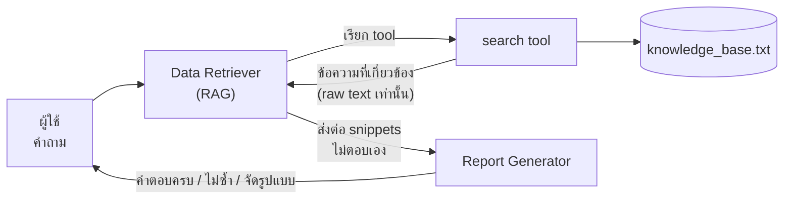

# โครงสร้างระบบ Multi-Agent + RAG

> Bangkok Bank — AI Engineer Programming Test

## Flowchart

## ความรับผิดชอบของ Agent

| Agent | ความรับผิดชอบ |
|-------|----------------|
| **Data Retriever** *(RAG)* | ค้นหาข้อมูลเฉพาะเจาะจงจากฐานความรู้ โดย **ไม่ตอบคำถามเอง** — จะส่งคืนเฉพาะข้อความที่เกี่ยวข้องเท่านั้น |
| **Report Generator** | รับข้อความจาก Data Retriever แล้วเรียบเรียงเป็นคำตอบที่ครบถ้วน ไม่ซ้ำซ้อน และจัดรูปแบบสวยงามให้ผู้ใช้ |
